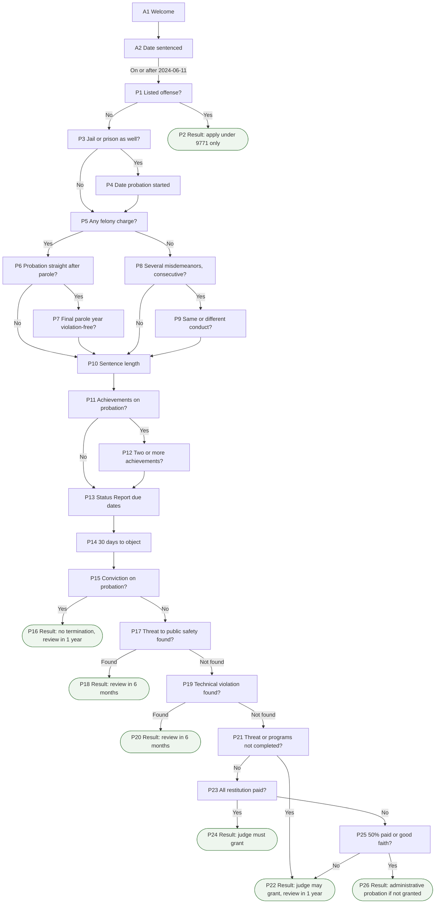
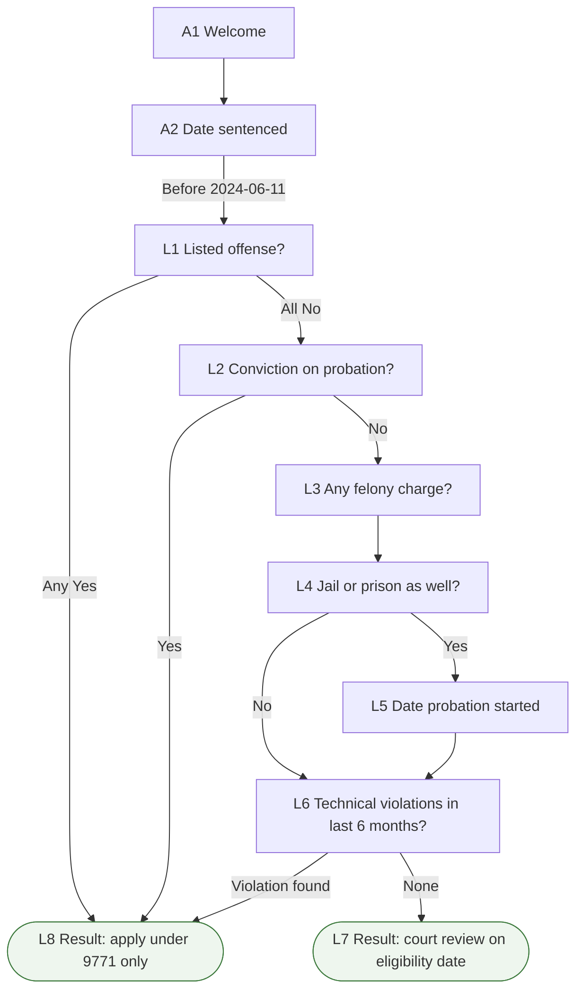

# Act 44 Early Termination Tool

A bilingual (English and Spanish) web tool from REFORM Alliance that helps people on probation in Pennsylvania navigate Act 44, which requires courts to assess people for early termination of probation or modification of probation conditions. It starts from the sentencing date and calculates the dates the person can act on.

**Live app:** <https://bfs6-act-44-early-termination-tool.share.connect.posit.cloud/>

Part of REFORM Alliance's early termination tools: [Georgia](https://github.com/REFORM-Alliance/georgia-early-termination-tool) · [Florida](https://github.com/REFORM-Alliance/florida-early-termination-tool) · [Illinois](https://github.com/REFORM-Alliance/illinois-early-termination-tool) · [Virginia](https://github.com/REFORM-Alliance/va-implementation-tool) · **Pennsylvania Act 44**.

## What it tells people

- **Sentenced on or after June 11, 2024:** a probation review conference pathway (`prc` in the code). The tool calculates an eligibility date, the date the Probation Status Report is due and the conference deadline, then walks through what the judge must decide.
- **Sentenced before June 11, 2024:** a shorter pathway (`section_7` in the code) that checks for disqualifiers, calculates an eligibility date and asks about technical violations in the 6 months before it.
- **Listed offenses or a disqualifying conviction:** the person may still apply under 42 Pa.C.S. 9771 at the judge's discretion, but is not eligible under Act 44.

## How the flow works

The tool is a scripted question-and-answer flow. A person answers one screen at a time, their answers choose the next screen, and a result screen says what they can do. Screens are numbered in the order a person meets them; each screen's code ID is its `question_id` in `app.R` (listed below the diagram).

**Sentenced on or after June 11, 2024**

**Sentenced before June 11, 2024**

Rounded boxes are result screens. Screens P13 to P15 and L6 and L7 show dates calculated from the answers. Result screens end at the thank-you page through the Finish button, not drawn.

Screen numbers and code IDs

| Screen | `question_id` |
| --- | --- |
| A1 | `intro_page` |
| A2 | `defendant_sentencing_date` |
| P1 | `prc_flow_q1` |
| P2 | `prc_result_1` |
| P3 | `prc_flow_split_sentence` |
| P4 | `prc_flow_probation_start_date` |
| P5 | `prc_flow_q2` |
| P6 | `prc_flow_q3_1` |
| P7 | `prc_flow_q3_1_final_year_parole` |
| P8 | `prc_flow_q3_2` |
| P9 | `prc_flow_q3_3` |
| P10 | `prc_flow_q4` |
| P11 | `prc_flow_q5` |
| P12 | `prc_flow_q6` |
| P13 | `prc_flow_q7` |
| P14 | `prc_flow_q8` |
| P15 | `prc_flow_q9` |
| P16 | `prc_flow_q9_result` |
| P17 | `prc_flow_q10` |
| P18 | `prc_flow_q10_result` |
| P19 | `prc_flow_q11` |
| P20 | `prc_flow_q11_result` |
| P21 | `prc_flow_q12` |
| P22 | `prc_flow_q12_result` |
| P23 | `prc_flow_q13` |
| P24 | `prc_flow_q13_result` |
| P25 | `prc_flow_q14` |
| P26 | `prc_flow_q14_result` |
| L1 | `section_7_q1` |
| L2 | `section_7_q1_1` |
| L3 | `section_7_q2` |
| L4 | `section_7_split_sentence` |
| L5 | `section_7_probation_start_date` |
| L6 | `section_7_q3` |
| L7 | `section_7_act_44_relief_result` |
| L8 | `no_act_44_relief_result` |
| F | `finished_page` |

## How the dates are calculated

These are the rules as coded in `app.R`.

| Rule | Pathway | What the code does |
| --- | --- | --- |
| Starting date | Both | The date probation started after jail or prison if given; otherwise the sentencing date. |
| Halfway point | `prc` | Starting date plus half the sentence in months; an odd month count adds 15 days. |
| Misdemeanor | `prc` | Earlier of starting date plus 2 years or the halfway point (one misdemeanor, or several for the same conduct). |
| Felony | `prc` | Earlier of starting date plus 4 years or the halfway point. |
| Several misdemeanors, different conduct | `prc` | Treated like a felony. |
| Achievements | `prc` | 6 months earlier for any listed achievement; a felony with two or more gets another 6 months earlier. |
| Parole before probation | `prc` | A felony where probation followed parole and the final parole year had no violations: another 12 months earlier. |
| Floor | `prc` | Never earlier than one year after sentencing. |
| Fixed term | `section_7` | Starting date plus 4 years (felony) or 2 years (misdemeanor), never before 2025-06-11. |
| Dates shown | Both | Status Report due: eligibility date minus 30 days. Conference deadline: plus 60 days. Violation window: minus 6 months to the eligibility date. |

Two dates are typed into `app.R`: `2024-06-11` chooses the pathway and `2025-06-11` is the earliest eligibility date on the `section_7` pathway.

## Repository layout

| File or folder | What it is |
| --- | --- |
| `app.R` | The whole app: packages, the `decision_tree` list (every screen and its routing), page layout and server logic. |
| `json/translation.json` | English-to-Spanish text pairs. The English text is the lookup key. |
| `www/reform-logo-charcoal.png` | The logo at the top of the page. Shiny serves everything in `www/` as-is. |
| `renv.lock`, `renv/`, `.Rprofile` | Pinned package versions. `.Rprofile` switches renv on when the project opens. |
| `manifest.json` | The R version and package list that Posit Connect Cloud builds the app from. Regenerate it with `rsconnect::writeManifest()` after any package change. |
| `act-44-flow-chart-app.Rproj` | The RStudio project file. The app finds `json/translation.json` relative to it. |
| `R/old-R/` | Earlier versions of the app and a script that converts translations to CSV. Not used by the current app. |
| `data/`, `json/translation_w_question_id.json` | Translation working files. Not read by the app. |
| `www/translation.json` | A second copy of the translations that differs from `json/translation.json`. The app reads `json/translation.json`. |
| `www/act-44-early-termination-flow-chart.png` | A flowchart image used by earlier versions; the current `app.R` does not reference it. |
| `rsconnect/` | Record of an earlier deployment to shinyapps.io (app `act-44-app`). Connect Cloud does not use it. |

The pinned versions are R 4.4.2 with the packages in `renv.lock`. The app loads `shiny`, `tidyverse`, `shinythemes`, `shinyWidgets`, `shinyjs`, `shinyalert`, `shiny.i18n`, `lubridate`, `scales`, `here`, `rsconnect` and `googleLanguageR`. The last two are loaded but never called, so no Google or hosting credentials are needed to run it.

## Run it locally

1. Install R 4.4.2 and the RStudio desktop app.
2. Clone or download this repo and double-click `act-44-flow-chart-app.Rproj`. RStudio opens the project and renv switches on by itself.
3. In the R console, run `renv::restore()` once. It installs the pinned package versions.
4. Open `app.R` and click **Run App**, or run `shiny::runApp()` in the console.
5. Switch the language picker to Spanish and click through every route you changed.

## Edit wording, questions and Spanish

- Each screen is one block in the `decision_tree` list at the top of `app.R`: `question_id` (its name), `question` or `result` (the text), `choices` (the answer buttons) and `next_question` (where each answer leads).
- After changing any English text, make the matching change to the `"en"` value in `json/translation.json` and rewrite its `"es"` value. Matching is exact, including punctuation and curly quotes, and text is translated in pieces around links and bold words. A miss shows that piece in English and logs a warning.
- Screen names must be unique and every name in `next_question` must exist, or Next does nothing. Keep the first screen as the welcome screen.
- Link to a statute with `tags$a(href='URL', target='_blank', class='external-link', "text")`. The `external-link` class triggers the "Leaving Application" confirmation.
- English and Spanish are written into the picker and the answer-lookup code in several places, so a third language needs code changes as well as a new column.

## Publish

This tool is hosted on [Posit Connect Cloud](https://connect.posit.cloud). The live app is at <https://bfs6-act-44-early-termination-tool.share.connect.posit.cloud/>. Connect Cloud copies the code from the GitHub repository and builds the app itself, so publishing an update means getting the change onto the GitHub branch that Connect Cloud follows (normally `main`; **Settings > Source** in Connect Cloud shows which). Nothing is uploaded from your computer. Connect Cloud addresses have the form `https://<account>-<custom name>.share.connect.posit.cloud`. The early termination tools' addresses of that form begin with `bfs6`, the name of the Connect Cloud account that owns them.

**Older shinyapps.io copy.** The `rsconnect/` folder records an earlier deployment of this tool to shinyapps.io as app `act-44-app` (https://ianwkt-basil0-seif.shinyapps.io/act-44-app/). Connect Cloud does not use that folder. If the shinyapps.io copy is still running it will not receive updates, so confirm whether to shut it down and make sure nobody is sent to it.

**Address and repo name differ.** The live address uses the name `act-44-early-termination-tool`, not the repo name `act-44-flow-chart-app`. The address comes from the custom name set in Connect Cloud, so the two do not have to match.

### Publish an update

1. Make and test the change on your computer (see **Run it locally**).
2. If you added or upgraded an R package, run `renv::snapshot()` and then `rsconnect::writeManifest()` in the R console, and commit both `renv.lock` and `manifest.json`. Connect Cloud reads `manifest.json` for the package list, so a stale one gives the live app the wrong packages or fails the build.
3. Commit and push to `main` (RStudio's Git tab, GitHub Desktop or the command line all work), or merge a pull request into it. "Automatically publish on push" is on by default, so Connect Cloud rebuilds and redeploys the app. The address does not change.
4. Open the live address, switch the language picker to Spanish and click through the routes you changed.
5. If the live app did not change, sign in to Connect Cloud, open the app's card on your Home page and look at the publish log for an error. **Republish** on the card redeploys from the latest code on GitHub.

### Publish for the first time, or re-create the app

1. In the project folder, run `rsconnect::writeManifest()` in the R console. Commit and push `app.R`, `manifest.json`, `json/` and `www/`.
2. Sign in to [Connect Cloud](https://connect.posit.cloud) with the account named `bfs6`, which owns the `share.connect.posit.cloud` addresses.
3. Click **Publish** at the top of your Home page. The first time, Connect Cloud asks you to install its GitHub App; give it access to this repository. A repo owned by the REFORM-Alliance organization may need an organization owner to approve the app.
4. Choose **Shiny**, then select this repository.
5. Confirm the **Branch** is `main` and the **Primary file** is `app.R`. Leave **Automatically publish on push** on.
6. Click **Publish** and watch the build log. When it finishes, the app is live at an address like `https://<content id>.share.connect.posit.cloud`.
7. Open the app's **Settings > URL** and set the custom name to `act-44-early-termination-tool`. The address becomes `https://bfs6-act-44-early-termination-tool.share.connect.posit.cloud`.
8. Open the address in a private browser window to check that someone who is not signed in to Connect Cloud can use it.

### If something goes wrong

- **The repository is missing from the Publish list.** Connect Cloud's GitHub App does not have access to it. Give the app access in GitHub, then reload the list. Automatic publishing also only works for repositories the app can reach.
- **Free accounts can publish only public repositories.** If this repository is ever made private, the Connect Cloud account needs a paid plan.
- **The build fails after a package change.** Run `rsconnect::writeManifest()` again, commit `manifest.json` and push.
- **No secrets to set.** `app.R` reads no environment variables, so nothing is needed under Advanced settings.

## Known issues

Found by reading the code; the app was not run. Confirm each before changing anything.

- `app.R` line 1269 compares the felony answer with itself, which is always true, so every respondent is saved as "Felony". The misdemeanor date rules are never reached, the `section_7` pathway always adds 4 years, and P12 is asked of everyone who answers Yes at P11. The intended test is presumably whether the answer is "Yes".
- P20 (technical violation found) says the next conference is 6 months after the date "this threat to public safety occurred", wording copied from P18.
- Typo in user-facing text: "uderlying" (P13). It is also a key in `json/translation.json`; fix both.
- Back does not re-tick earlier answers in this tool, unlike the state tools.
- Several screens (P17, P19, L6) ask what a judge found or will find at the conference. They are hypotheticals, not facts the person knows.

## Keep the sibling repos in step

The five early termination tools copy the same engine rather than sharing a package. A fix to how the app behaves, as opposed to what it says, should be repeated in the other repos.

| Tool | Repository | Live app |
| --- | --- | --- |
| Georgia | [georgia-early-termination-tool](https://github.com/REFORM-Alliance/georgia-early-termination-tool) | <https://bfs6-georgia-early-termination-tool.share.connect.posit.cloud/> |
| Florida | [florida-early-termination-tool](https://github.com/REFORM-Alliance/florida-early-termination-tool) | <https://bfs6-florida-early-termination-tool.share.connect.posit.cloud/> |
| Illinois | [illinois-early-termination-tool](https://github.com/REFORM-Alliance/illinois-early-termination-tool) | <https://bfs6-illinois-early-termination-tool.share.connect.posit.cloud/> |
| Virginia | [va-implementation-tool](https://github.com/REFORM-Alliance/va-implementation-tool) | <https://www.reformvaearlyterminationtool.com/> |
| Pennsylvania Act 44 | [act-44-flow-chart-app](https://github.com/REFORM-Alliance/act-44-flow-chart-app) | <https://bfs6-act-44-early-termination-tool.share.connect.posit.cloud/> |